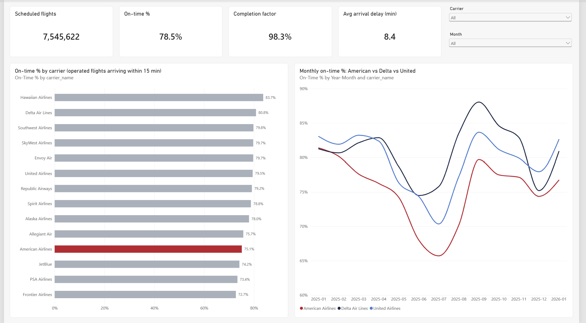
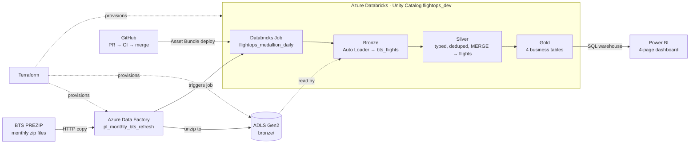
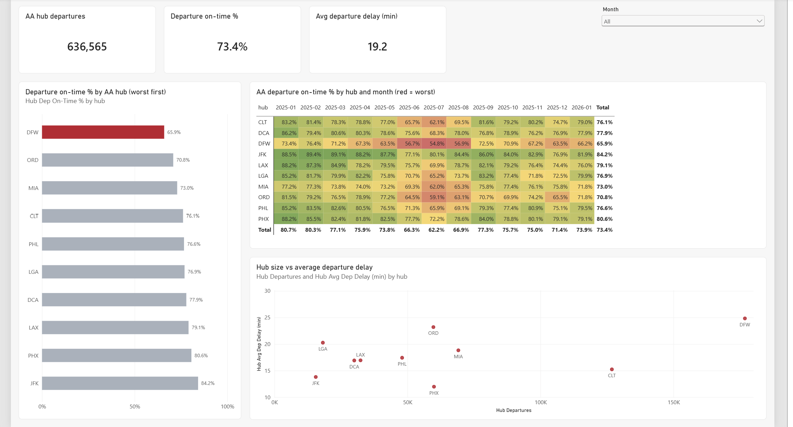
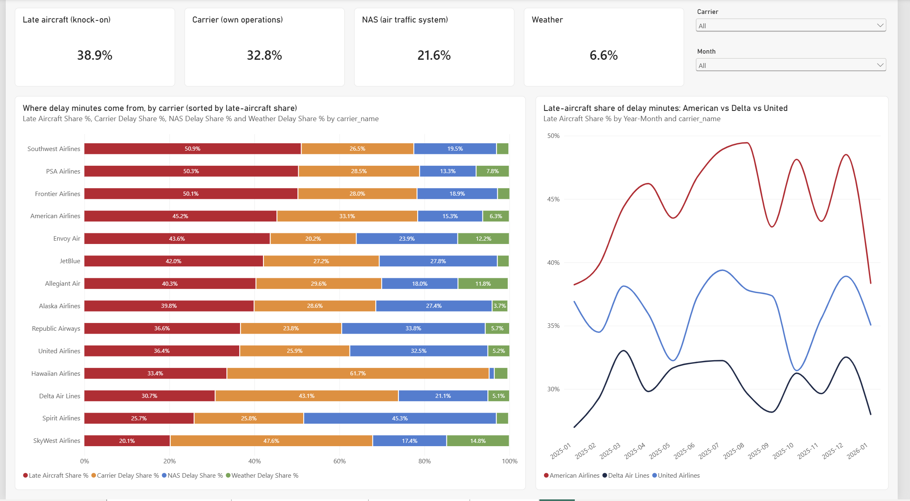

# Flight Operations Data Platform (Azure + Databricks)

An end-to-end data platform on Azure that ingests U.S. airline on-time performance data, refines it through a Databricks medallion architecture, and serves an operations dashboard in Power BI, with infrastructure as code, scheduled orchestration, and CI/CD.

**Data:** Bureau of Transportation Statistics (BTS) On-Time Performance, **7.5M flights** (Jan 2025 – Jan 2026, 14 carriers).
**Focus:** American Airlines network performance against Delta and United.



---

## Key findings

| Finding | Evidence (2025) |
|---|---|
| AA trails its main competitors on on-time arrival | AA **75.0%** vs Delta 80.8% and United 79.2% (operated flights arriving ≤15 min late) |
| AA's delays are mostly knock-on delays | **45.7%** of AA delay minutes are *late-arriving aircraft*, vs Delta 30.8% and United 36.5% |
| DFW, AA's largest hub, is the weakest | DFW departure on-time **66.2%** (worst of 10 hubs) vs JFK 84.5% (best) |
| Summer is the stress point | DFW fell to **54.8%** departure on-time in July 2025; the 10-hub average dropped to 62–67% from June to August |

**Takeaway:** AA's on-time gap is driven less by weather or air traffic control and more by **delay propagation through its hub network**. A late aircraft at DFW turns into late departures across the system. Faster DFW turnarounds would have an outsized effect on systemwide performance.

---

## Architecture



| Layer | Technology | What it does |
|---|---|---|
| Infrastructure | Terraform (remote state in Azure Storage) | Resource group, ADLS Gen2 (bronze/silver/gold), Key Vault, Databricks workspace + access connector, Data Factory, role assignments |
| Ingestion | Azure Data Factory (Git-integrated) | Downloads a BTS month, unzips it into bronze, then triggers the Databricks job |
| Scheduling | ADF schedule trigger | Runs on the 20th of each month at 06:00 UTC and loads the month two months back (BTS publishing lag) |
| Bronze | Auto Loader (`cloudFiles`, `availableNow`) | Incremental, idempotent CSV ingestion; all columns kept as raw strings plus source-file lineage |
| Silver | PySpark + Delta MERGE | 24 typed columns, hashed business key, dedup, liquid clustering, data quality checks |
| Gold | Spark SQL | Carrier daily KPIs, AA hub performance, delay cause mix, route performance |
| Governance | Unity Catalog | Catalog per environment, schema per layer, storage credential via managed identity |
| BI | Power BI (Import mode, `.pbip` project) | Star schema, 15 DAX measures, 4 report pages |
| CI/CD | GitHub Actions + Databricks Asset Bundles | Required PR checks; auto-deploy on merge via an OAuth service principal |

---

## Pipeline details

### Ingestion (ADF)
- `pl_ingest_bts_month`: HTTP → ADLS copy with on-read unzip into `bronze/bts/year=YYYY/month=M/`
- `pl_backfill_bts_year`: parallel ForEach (batch of 4) over 12 months, used for the 2025 backfill
- `pl_monthly_bts_refresh`: computes the target month, runs the ingest, then calls the Databricks job
- `tr_monthly_bts_refresh`: schedule trigger that passes `year`/`month` derived from `trigger().scheduledTime`, so a rerun of a missed trigger still loads the correct month

### Medallion layers (Databricks)
- **Bronze** (`flightops_dev.bronze.bts_flights`): Auto Loader with schema location and checkpoint. A rerun with no new files loads 0 rows.
- **Silver** (`flightops_dev.silver.flights`): `flight_key = SHA-256(date | carrier | flight number | origin | dest | scheduled departure)`. Window dedup and Delta `MERGE` make reruns idempotent. Liquid clustering on `(flight_date, carrier)`.
- **Gold** (`flightops_dev.gold.*`): `carrier_daily_performance`, `aa_hub_performance`, `delay_cause_breakdown`, `route_performance`, each with a table `COMMENT` documenting its metric definitions.

**Data quality checks (silver):** null business keys (fails the job), invalid airport codes, unparsed departure times, and cancelled flights carrying an arrival delay. All pass on the current data.

**Reconciliation:** bronze = silver = **7,545,622 rows**, with 7,545,622 unique `flight_key`s.

### Orchestration
One Databricks job with three tasks (`bronze_autoloader → silver_flights → gold_metrics`) on a shared single-node job cluster (`Standard_D4a_v4`, DBR 17.3 LTS). The job definition lives in [`resources/flightops_medallion_daily.job.yml`](resources/flightops_medallion_daily.job.yml) and is deployed as a Databricks Asset Bundle.

### Power BI
- **Model:** star schema with `Date` and `Carrier` dimensions filtering four gold fact tables through single-direction 1:* relationships
- **Measures:** ratios are rebuilt from counts and averages are weighted by flight volume, so numbers stay correct at any aggregation level
- **Validated** against SQL: AA 2025 = 973,653 flights, late-aircraft share 45.7%
- **Pages:** Network Overview · AA Hub Performance · Delay Causes · Routes

| | |
|---|---|
|  |  |

### CI/CD
| Trigger | Workflow | Steps |
|---|---|---|
| Pull request to `main` | [`ci.yml`](.github/workflows/ci.yml) | `terraform fmt -check`, `terraform validate`, notebook JSON check, bundle YAML check |
| Merge to `main` (Databricks paths only) | [`deploy.yml`](.github/workflows/deploy.yml) | `databricks bundle validate` + `deploy` as service principal `sp-github-deploy` (OAuth M2M) |

`main` is protected by a ruleset: PRs are required and both CI checks must pass before merging. The bundle pins its `root_path` and `run_as`, so CI deployments update the existing job that ADF triggers instead of creating a duplicate.

---

## Engineering notes: problems found and fixed

| Problem | How it was found | Fix |
|---|---|---|
| **Business-key collision** dropped one flight | Silver had 1 row fewer than bronze after the Jan 2026 load | F9 3237 on 2026-01-04 had two JFK legs at 06:59 to different destinations. Added `dest` to `flight_key` and rebuilt silver from bronze. |
| **Azure vCPU quota** (4 cores) blocked the job cluster | Job failed with `AZURE_QUOTA_EXCEEDED_EXCEPTION` | The interactive and job clusters competed for the same quota. Manage cluster lifecycle, and use a VM family with available cores. |
| Folder `year=` vs CSV column `Year` clash | Auto Loader schema error | `cloudFiles.partitionColumns = ""` |
| BTS file names have no zero-padded months | 404 on `_2026_01.zip` | `string(int(formatDateTime(..., 'MM')))` |
| ADF trigger created in the wrong time zone (UTC−12) | Inspected the published ARM template | Set UTC explicitly, and moved year/month into trigger parameters |
| Bundle uploaded the whole repo (94 files) | Deploy output | `sync.exclude` limits workspace files to `src/` |

---

## Repository layout

```
.github/workflows/   ci.yml (PR checks), deploy.yml (bundle deploy)
adf/                 Data Factory pipelines, datasets, linked services, trigger (Git-integrated)
infra/               Terraform for all Azure resources
src/notebooks/       bronze/, silver/, gold/ Databricks notebooks
resources/           Databricks Asset Bundle job definition
databricks.yml       Bundle config (target, root_path, run_as, sync rules)
powerbi/             Power BI project (.pbip): report + semantic model as text
docs/                Dev log and dashboard screenshots
```

---

## Running it yourself

**Prerequisites:** Azure subscription, Terraform, Databricks CLI ≥ 0.218, Power BI Desktop.

1. **Infrastructure:** `cd infra && terraform init && terraform apply`. Set `subscription_id` in a local, gitignored `terraform.tfvars`.
2. **Unity Catalog:** create the storage credential (access connector), external locations, and the `flightops_dev` catalog with `bronze`/`silver`/`gold` schemas.
3. **Data Factory:** connect ADF to this repo (root `/adf`, collaboration branch `main`), then publish. Run `pl_backfill_bts_year` for history.
4. **Databricks job:** `databricks bundle deploy` (or merge to `main` and let the Deploy workflow do it).
5. **Power BI:** open `powerbi/flightops_dashboard.pbip`, point the data source at your SQL warehouse, and refresh.

---

## Tech stack

Azure Data Factory · Azure Data Lake Storage Gen2 · Azure Databricks · Delta Lake · Unity Catalog · Auto Loader · PySpark · Spark SQL · Terraform · Databricks Asset Bundles · GitHub Actions · Power BI · DAX
